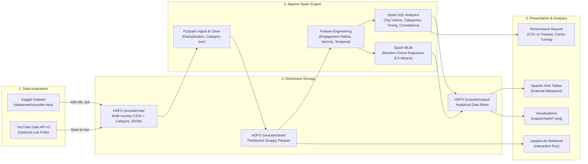

# YouTube Video Statistics Analysis Using Hadoop and Apache Spark

[](https://spark.apache.org/)
[](https://hadoop.apache.org/)
[](https://www.python.org/)
[](https://www.docker.com/)

A comprehensive, production-grade big data pipeline that analyzes views, likes, and audience engagement trends across multiple countries using **Hadoop HDFS**, **Apache Spark (PySpark & Spark SQL)**, **Spark MLlib**, and **Matplotlib / Seaborn**.

---

## 1. System Architecture



---

## 2. Project Directory Structure

```text
youtube-statistics-bigdata/
├── config/
│   ├── __init__.py
│   └── config.py                 # Central configuration for paths (HDFS vs Local), Spark master, thresholds
├── data/
│   ├── raw/                      # Multi-country CSVs (US, IN, GB, CA) & Category ID JSON mappings
│   ├── clean/                    # Cleaned & feature-engineered Parquet datasets (partitioned by country)
├── docker/
│   ├── docker-compose.yml        # Multi-container Hadoop (Namenode/Datanode) + Spark (Master/Worker)
│   ├── Dockerfile                # PySpark + Big Data processing client container
│   └── hadoop.env                # Hadoop cluster environment configurations
├── docs/
│   └── REPORT.md                 # Full academic & engineering project report with deep insights
├── notebooks/
│   └── youtube_analysis_pipeline.ipynb # Complete interactive Jupyter Notebook
├── output/
│   ├── charts/                   # Generated Matplotlib/Seaborn publication plots
│   ├── tables/                   # Aggregated CSV/JSON analytical results
│   └── reports/                  # Performance benchmarks and markdown summaries
├── scripts/
│   ├── 00_download_data.py       # Kaggle dataset downloader (kaggle CLI or Python API)
│   ├── 01_fetch_youtube_api.py   # YouTube Data API v3 live fetcher (.env support)
│   ├── 02_hdfs_setup.sh          # Linux/macOS HDFS directory setup and upload script
│   ├── 02_hdfs_setup.bat         # Windows HDFS setup counterpart
│   ├── 03_ingest_and_clean.py    # Spark multiline CSV reader, date parsing, category join, Parquet write
│   ├── 04_feature_engineering.py # Engagement rate, days to trend, temporal buckets, text metrics
│   ├── 05_spark_sql_analysis.py  # Spark SQL & DataFrame analytical queries (8 core queries)
│   ├── 06_spark_mllib.py         # MLlib Regression (Random Forest & Linear) & K-Means clustering
│   ├── 07_visualize_results.py   # Publication-grade Matplotlib & Seaborn chart generator
│   ├── 08_benchmark_tuning.py    # Performance comparison (CSV vs Parquet, caching, repartitioning)
│   ├── generate_sample_data.py   # Synthetic realistic test data generator
│   └── hive_tables.sql           # Hive DDL scripts for external tables and views
├── .env.example                  # Environment template for API keys and cluster endpoints
├── .gitignore                    # Standard Python, Spark, and OS ignores
├── requirements.txt              # Complete Python library dependencies
├── run_all.py                    # Cross-platform master runner (runs entire pipeline in 1 command)
├── run_all.sh                    # Bash master runner
├── run_all.bat                   # Windows batch master runner
└── README.md                     # Comprehensive setup and usage documentation
```

---

## 3. Quickstart: Run in 3 Minutes (Local Standalone Mode)

The pipeline is pre-configured to work **out-of-the-box locally** on any machine (Windows, Linux, or macOS) with zero external cluster setup required!

### Step 1: Clone and Set Up Python Environment
```bash
# Navigate into the project directory
cd "youtube statics"

# Create a virtual environment
python -m venv .venv

# Activate virtual environment
# On Linux/macOS:
source .venv/bin/activate
# On Windows (cmd):
.venv\Scripts\activate.bat
# On Windows (PowerShell):
.venv\Scripts\Activate.ps1

# Install dependencies
pip install -r requirements.txt
```

### Step 2: Run the Complete Pipeline
Execute the master runner to execute all steps end-to-end:
```bash
# Cross-platform Python runner:
python run_all.py

# Or on Linux/macOS:
bash run_all.sh

# Or on Windows:
run_all.bat
```

### Step 3: Launch the Interactive Web Frontend Dashboard
You can view the interactive dashboard in two ways:
1. **Directly open in browser (Zero-config)**: Double-click [`frontend/index.html`](file:///c:/Users/Ram%20Singh%20Bairwa/OneDrive/Desktop/youtube%20statics/frontend/index.html).
2. **Via local web server**:
   ```bash
   python server.py
   ```
   Then open `http://localhost:5000` in your web browser.

---

## 4. Docker Deployment: Full Hadoop & Spark Cluster

For complete isolation and authentic distributed operation, deploy the bundled Docker Compose stack:

### Step 1: Start the Cluster
```bash
cd docker
docker compose up -d
```
This provisions:
- **Hadoop NameNode** on `http://localhost:9870` (HDFS URI: `hdfs://localhost:9000`)
- **Hadoop DataNode** on `http://localhost:9864`
- **Apache Spark Master** on `http://localhost:8080` (Spark URI: `spark://spark-master:7077`)
- **Apache Spark Worker** on `http://localhost:8081`
- **JupyterLab / PySpark Client** on `http://localhost:8888`

### Step 2: Run the Pipeline Inside Docker
```bash
docker exec -it youtube-spark-client bash
python run_all.py
```

### Step 3: Interactive JupyterLab
Open your browser to `http://localhost:8888` and open `notebooks/youtube_analysis_pipeline.ipynb`.

---

## 5. Hadoop & Spark Cluster Setup (Native Pseudo-Distributed)

If setting up Apache Hadoop and Spark directly on a Linux/macOS/WSL machine:

### 1. Prerequisites
- **Java**: OpenJDK 8 or 11 (`sudo apt install openjdk-11-jdk`)
- **Hadoop**: 3.3.x or 3.4.x
- **Spark**: 3.5.x

### 2. Configure Hadoop XML Files
Add the following to `$HADOOP_HOME/etc/hadoop/`:

#### `core-site.xml`:
```xml
<configuration>
    <property>
        <name>fs.defaultFS</name>
        <value>hdfs://localhost:9000</value>
    </property>
</configuration>
```

#### `hdfs-site.xml`:
```xml
<configuration>
    <property>
        <name>dfs.replication</name>
        <value>1</value>
    </property>
</configuration>
```

#### `yarn-site.xml`:
```xml
<configuration>
    <property>
        <name>yarn.nodemanager.aux-services</name>
        <value>mapreduce_shuffle</value>
    </property>
</configuration>
```

### 3. Start Hadoop Daemons
```bash
# Format HDFS (first time only)
hdfs namenode -format

# Start HDFS daemons (NameNode + DataNode)
start-dfs.sh

# Start YARN Resource Manager & Node Manager
start-yarn.sh

# Verify running daemons
jps
```

### 4. Upload Raw Datasets to HDFS
```bash
# Create directory structure
hdfs dfs -mkdir -p /youtube/raw
hdfs dfs -mkdir -p /youtube/clean
hdfs dfs -mkdir -p /youtube/output

# Upload raw CSV and JSON files
hdfs dfs -put -f data/raw/*.csv /youtube/raw/
hdfs dfs -put -f data/raw/*.json /youtube/raw/

# Verify upload
hdfs dfs -ls /youtube/raw
```

### 5. Enable HDFS Mode in Pipeline
In `.env` or your terminal:
```bash
export USE_HDFS=true
export HDFS_NAMENODE=hdfs://localhost:9000
python run_all.py
```

---

## 6. Step-by-Step Pipeline Guide

### Step 0: Data Acquisition (Kaggle Dataset)
Download the official dataset using Kaggle CLI or Python API:
```bash
# Using script:
python scripts/00_download_data.py

# Or directly via Kaggle CLI:
kaggle datasets download -d datasnaek/youtube-new -p data/raw --unzip
```

### Step 1: Optional Live YouTube Data API v3 Ingestion
Fetch current live trending statistics:
1. Copy `.env.example` to `.env`.
2. Add your Google Cloud API key: `YOUTUBE_API_KEY=AIzaSy...`
3. Run:
```bash
python scripts/01_fetch_youtube_api.py
```

### Step 3: PySpark Ingest, Clean, & Parquet Export
- Ingests multi-country CSVs with `multiLine=True` and `escape='"'`.
- Extracts `country` code from the file path.
- Deduplicates snapshots on `(video_id, trending_date)`.
- Parses `trending_date` (`yy.dd.MM` -> Date) and `publish_time` (ISO 8601 -> Timestamp).
- Joins with category JSON mappings.
- Writes to Snappy-compressed Parquet partitioned by `country`.
```bash
python scripts/03_ingest_and_clean.py
```

### Step 4: Feature Engineering
Derives predictive and diagnostic metrics:
- **Engagement**: `like_ratio`, `dislike_ratio`, `engagement_rate = (likes + dislikes + comment_count) / views`
- **Velocity**: `days_to_trend = trending_date - publish_date`
- **Temporal**: `publish_hour`, `publish_weekday`, `publish_year_month`
- **Text & Metadata**: `tag_count`, `title_length`, `title_word_count`, `is_viral`
```bash
python scripts/04_feature_engineering.py
```

### Step 5: Spark SQL & DataFrame Analysis
Executes 8 core analytical queries and exports tables:
1. Top 10 Most Viewed & Liked Videos
2. Top 10 Channels by Views and Total Engagement
3. Category Aggregates (Mean Views, Likes, Engagement Rate)
4. Country-Wise Comparison
5. Monthly Engagement Trends Over Time
6. Optimal Publishing Windows (Hour vs Weekday)
7. Pearson Correlation Matrix between interaction metrics
8. Impact of Tag Count, Title Length, and Interaction Restrictions
```bash
python scripts/05_spark_sql_analysis.py
```

### Step 6: Spark MLlib Machine Learning
- **Regression**: Trains `RandomForestRegressor` and `LinearRegression` to predict video views. Evaluates **RMSE**, **$R^2$**, and **MAE**, and reports Gini Feature Importances.
- **Clustering**: Scaled $K$-Means ($k=4$) on engagement vectors (`views`, `likes`, `comment_count`, `engagement_rate`). Reports Silhouette score and cluster centroids.
```bash
python scripts/06_spark_mllib.py
```

### Step 7: Publication-Grade Visualizations
Generates 8 high-resolution (300 DPI) charts in `output/charts/`:
```bash
python scripts/07_visualize_results.py
```
- `01_top_10_videos_views.png`: Horizontal bar chart of top trending videos.
- `02_category_engagement_analysis.png`: Dual-axis view count vs engagement rate by category.
- `03_country_comparison.png`: Cross-country view and engagement profile.
- `04_best_publish_timing_heatmap.png`: Heatmap of optimal upload day & hour.
- `05_monthly_trends_line.png`: Time-series trajectory of views and uploads.
- `06_correlation_matrix_heatmap.png`: Pearson correlation heatmap.
- `07_mllib_feature_importances.png`: Gini importance bar chart.
- `08_mllib_engagement_clusters.png`: 2D scatter of audience engagement clusters.

### Step 8: Performance Tuning & Benchmarks
Measures and logs big data engineering metrics:
- **CSV vs Parquet**: File size compression ratio and scan speedup.
- **In-Memory Caching**: Speedup ratio of `.cache()` across repeated analytical iterations.
- **Partition Pruning**: I/O reduction when filtering on partition key `country`.
```bash
python scripts/08_benchmark_tuning.py
```

---

## 7. Apache Hive Integration

To query the HDFS Parquet dataset and analytical marts via HiveQL or Beeline:
```bash
beeline -u jdbc:hive2://localhost:10000 -f scripts/hive_tables.sql
```
This creates:
- External table `raw_youtube_videos` over `/youtube/raw`
- Partitioned external table `youtube_features` over `/youtube/clean/youtube_features.parquet`
- Analytical views: `v_top_10_videos`, `v_category_summary`, `v_country_velocity`

---

## 8. Troubleshooting & FAQ

1. **`UnsatisfiedLinkError` / `winutils.exe` on Windows**:
   - PySpark runs on Windows out-of-the-box in local mode. If using native Hadoop on Windows, ensure `winutils.exe` and `hadoop.dll` are in `%HADOOP_HOME%\bin`.
2. **Multiline CSV parsing errors**:
   - Always ensure `multiLine=True` and `escape='"'` are enabled when reading raw Kaggle CSVs to prevent newline breaks in description fields.
3. **Out of Memory (OOM) on large country datasets**:
   - Increase driver memory in `config/config.py`: `SPARK_DRIVER_MEMORY=8g`.
4. **Spark Python version mismatch**:
   - Set environment variables to match Python executable:
     ```bash
     export PYSPARK_PYTHON=python
     export PYSPARK_DRIVER_PYTHON=python
     ```

---
*Created as part of the Advanced Big Data Engineering Series.*

